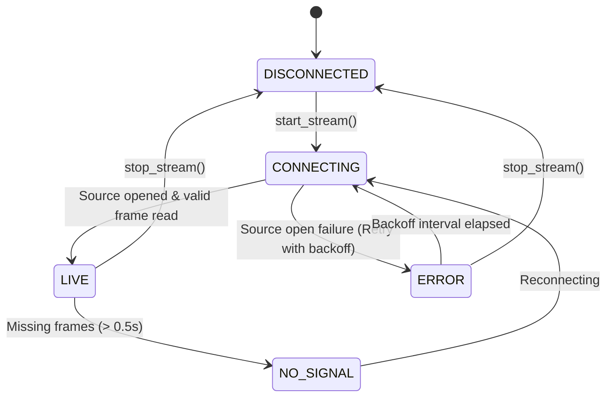

# Rover Mission Control — Video Subsystem Architecture

## 1. Executive Summary & Chosen Architecture

The selected camera streaming architecture is a **Hybrid Dedicated RTSP / H.264 Video Transport with a Decoupled PySide6 Receiver and Stale Frame Dropping**.

```
+-----------------------------------------------------------------------------------+
|               NVIDIA Jetson Orin Nano (Ubuntu 22.04 LTS / ROS 2)                  |
|                                                                                   |
|  [Front Camera (CSI / USB V4L2)]                                                  |
|                 │ (Raw NVMM / YUYV)                                               |
|                 ▼                                                                 |
|  [GStreamer Pipeline: nvv4l2h264enc / x264enc]  <-- Hardware Accelerated H.264   |
|                 │ (H.264 Elementary Stream, Zerolatency, CBR 2.5 Mbps)            |
|                 ▼                                                                 |
|  [RTSP Stream Server (MediaMTX / rtsp-simple-server)]                             |
+─────────────────│─────────────────────────────────────────────────────────────────+
                  │ Dedicated RTSP / UDP Stream (rtsp://<rover_ip>:8554/front_camera)
                  │ Bandwidth: ~2.5 Mbps | Expected Glass-to-Glass Latency: ~65-95 ms
+─────────────────│─────────────────────────────────────────────────────────────────+
|                 ▼                                                                 |
|  [Network Ingest & Hardware Decoder (OpenCV / PyAV Ingest Engine)]                |
|                 │ (BGR24 Decoded Frames)                                          |
|                 ▼                                                                 |
|  [BoundedFrameBuffer (Capacity: 2)]  <-- Drops Stale Frames if UI Falls Behind   |
|                 │                                                                 |
|                 ├──────────────────────────────┐                                  |
|                 ▼                              ▼                                  |
|  [StreamStatisticsTracker]           [VideoWorker (QThread)]                      |
|  - Ingestion / Displayed FPS                   │                                  |
|  - Latency / Dropped Frames                    │ Qt Signals (QueuedConnection)   |
|  - Stream Health / Uptime                      ▼                                  |
|                              [LiveVideoPlayerWidget (Qt Main UI Thread)]          |
|                              - 16:9 Aspect Ratio Locked Canvas                    |
|                              - 🔴 LIVE HUD Overlay (YouTube Style)               |
|                              - Fullscreen Mode / Status Overlays                  |
|                                                                                   |
|                      Mission Control (Windows Laptop)                             |
+-----------------------------------------------------------------------------------+
```

---

## 2. Evaluation of Streaming Alternatives

| Architecture | End-to-End Latency | Bandwidth (720p@30) | Jetson CPU/GPU Impact | Windows / PySide6 Fit | Stale Frame Dropping | Overall Verdict |
| :--- | :--- | :--- | :--- | :--- | :--- | :--- |
| **1. ROS 2 `Image` (Raw)** | High ($>250\text{ ms}$) | Critical ($>660\text{ Mbps}$) | High CPU (DDS serialization) | Direct | Poor (DDS buffer queues) | **REJECTED** (Saturates WiFi/LAN). |
| **2. ROS 2 `CompressedImage`** | Moderate ($120\text{--}180\text{ ms}$) | Medium ($15\text{--}25\text{ Mbps}$) | Medium (JPEG per frame) | Native | Fair | **FALLBACK ONLY** (Higher bandwidth than H.264). |
| **3. MJPEG over HTTP** | Moderate ($150\text{--}220\text{ ms}$) | High ($20\text{--}35\text{ Mbps}$) | High CPU per frame | Simple | Fair | **REJECTED** (Inefficient compression). |
| **4. Dedicated RTSP + H.264 (Selected)** | **Low ($60\text{--}90\text{ ms}$)** | **Optimal ($2\text{--}3.5\text{ Mbps}$)** | **Minimal (Jetson NVENC Hardware)** | **Excellent (OpenCV/PyAV/Qt)** | **Guaranteed (Buffer limit = 2)** | **SELECTED (Optimal Balance)**. |
| **5. Raw RTP/UDP H.264** | Very Low ($45\text{--}75\text{ ms}$) | Optimal ($2\text{--}3.5\text{ Mbps}$)** | Minimal (Jetson NVENC) | Moderate | Manual SDP configuration | **STRONG SECONDARY** (More brittle session management). |
| **6. WebRTC** | Low ($80\text{--}120\text{ ms}$) | Optimal ($1.5\text{--}3\text{ Mbps}$) | Moderate | Complex (Signaling server/C++ libs) | Handled by WebRTC engine | **REJECTED** (Over-engineered for LAN robotics). |
| **7. QtMultimedia (QMediaPlayer)** | Variable ($180\text{--}400\text{ ms}$) | Optimal ($2\text{--}3.5\text{ Mbps}$) | Minimal | Built-in | Hard to drop frames directly | **REJECTED** (Opaque DirectShow pipeline). |

---

## 3. Detailed Technical Rationale

1. **Jetson Orin Nano Hardware Acceleration**: The Jetson Orin Nano contains dedicated hardware video encoding hardware (NVENC). Using GStreamer's `nvv4l2h264enc` consumes less than $3\%$ CPU utilization on the Jetson while delivering real-time H.264 compression with zero-latency tuning (`tune=zerolatency`, `iframeinterval=15`).
2. **Network Efficiency & Arena Stability**: A 720p 30 FPS raw stream demands over $660\text{ Mbps}$, crashing local WiFi links. H.264 compression reduces this to **$2.5\text{ Mbps}$** (a $99.6\%$ bandwidth reduction) with pristine visual fidelity for operator driving.
3. **Strict UI Thread Isolation**: All video decoding, network stream polling, and statistics monitoring execute in a background `QThread` (`VideoWorker`). The PySide6 UI thread only receives ready-to-paint `QImage` objects via Qt queued signals.
4. **Stale Frame Dropping**: In remote teleoperation, displaying a delayed frame is dangerous. The `BoundedFrameBuffer` enforces a maximum capacity of 2 frames. If rendering is delayed, the oldest frame is discarded immediately, guaranteeing that the operator always sees real-time telemetry.

---

## 4. Jetson-Side Pipeline Specification

### Production GStreamer Command (CSI / V4L2 USB Camera)
```bash
gst-launch-1.0 -v v4l2src device=/dev/video0 ! \
    "video/x-raw, width=1280, height=720, framerate=30/1" ! \
    nvvidconv ! \
    "video/x-raw(memory:NVMM), format=NV12" ! \
    nvv4l2h264enc maxperf-enable=1 bitrate=2500000 control-rate=1 iframeinterval=15 preset-level=1 insert-sps-pps=1 ! \
    h264parse ! \
    rtspclientsink location=rtsp://localhost:8554/front_camera
```

### MediaMTX RTSP Server Configuration
On the Jetson, MediaMTX (single binary RTSP server) runs as a systemd daemon:
- Port: `8554` (RTSP)
- Path: `/front_camera`
- Transport: UDP/TCP with low-latency zero-buffer delivery.

---

## 5. Windows Mission Control Ingestion & Rendering

### Threading Model
- **Worker Thread (`VideoWorker`)**:
  - Ingests video from `BaseVideoSource` (OpenCV RTSP/Webcam or Synthetic Test Pattern).
  - Pushes decoded `QImage` to `BoundedFrameBuffer`.
  - Dispatches `frame_ready(QImage, FrameMetadata)` and `stats_updated(StreamStats)` signals.
- **Main UI Thread (`LiveVideoPlayerWidget`)**:
  - `VideoCanvas` renders the frame scaled into a locked 16:9 viewport using smooth bilinear interpolation.
  - Draws black pillarbox/letterbox bands automatically when resized.
  - Overlays real-time YouTube-style HUD: 🔴 LIVE badge, resolution, displayed FPS, and latency.
  - Toggles fullscreen mode via button or `Esc` key.

---

## 6. Reconnection & Stream Resilience



- Exponential backoff starting at $1.0\text{s}$ up to $8.0\text{s}$.
- Automatic reconnection attempt counter displayed on operator HUD.
- No UI lockup or blocking dialogs during connection loss.

---

## 7. Prototype & Test Verification

- **Local Prototype**: `TestPatternVideoSource` generates synthetic 16:9 ($1280\times 720$) color calibration frames with dynamic rotation sweep reticles, microsecond timestamps, frame counters, and simulated latency.
- **OpenCV Ingestion**: `OpenCVVideoSource` provides plug-and-play support for local USB webcams, recorded MP4 test videos, and live RTSP test streams (`rtsp://...`).
- **Automated Tests**: 25 comprehensive pytest unit and integration tests covering buffer bounding, stale frame dropping, statistics rolling window, state transitions, and thread shutdown safety.
